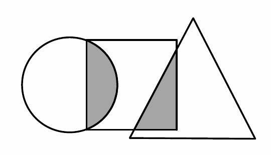
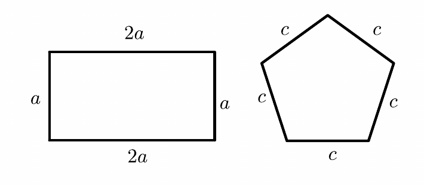

# 每日三题第1周 + 日积月累第1讲 · 错题整理

> 顾景源 · 五年级数学 · 学而思秋季班  
> **打印版：** `每日三题第1周+日积月累第1讲-错题整理.pdf`

---

## 第 1 题　（W1-Day1-1）

先化简下面各比，再求比值。（从第 1 行开始，从左往右填完再填第 2 行）

| | a | c |
|------|------|------|
| 比 | 0.15 : 0.3 | 0.24 : $\frac{2}{5}$ |
| 化简后的比 | | |
| 比值 | | |

## 第 2 题　（W1-Day1-3）

一个比例式的前两项互为倒数，比值为 4，内项积为 4，这个比例式的两个外项之和是 __________ 。

## 第 3 题　（W1-Day2-4）

用 $\frac{1}{4}$、$\frac{1}{6}$、8、12 这四个数组成比例，下面选项中正确的是（　　）。

A. $\frac{1}{6} : \frac{1}{4} = 12 : 8$

B. $8 : \frac{1}{4} = \frac{1}{6} : 12$

C. $\frac{1}{6} : \frac{1}{4} = 8 : 12$

## 第 4 题　（W1-Day3-8）

求比值：$123 : 123\frac{123}{124} =$ __________ .

## 第 5 题　（W1-Day3-9）

如图，长方形中左侧阴影部分的面积占圆面积的 $\frac{1}{8}$，占长方形面积的 $\frac{3}{10}$，长方形右侧阴影部分面积占大三角形面积的 $\frac{2}{15}$，占长方形面积的 $\frac{1}{5}$，则圆、长方形、大三角形的面积的最简整数比是 __________ 。

## 第 6 题　（W1-Day4-10）

如图，若长方形的周长是正五边形周长的 1.5 倍，则 a : c = __________ : __________ 。

## 第 7 题　（W1-Day4-11）

已知 $a : b = \frac{3}{2} : 1.2$，$b : c = 0.75 : \frac{1}{2}$，那么 c : a = __________ 。（写成最简整数比）

## 第 8 题　（W1-Day4-12）

已知甲、乙、丙三个数，甲的一半等于乙的 3 倍，也等于丙的 $\frac{2}{3}$，那么甲的 $\frac{2}{3}$、乙的 2 倍、丙的一半，这三个数的比为多少？

答：__________

## 第 9 题　（第1讲-融会贯通-7）

*校内：【2025 年 XSC 真题】*

如果 $x$ 与 $y$ 互为倒数，且 $x : 8 = \frac{a}{y}$，那么 $14a =$ __________ 。
