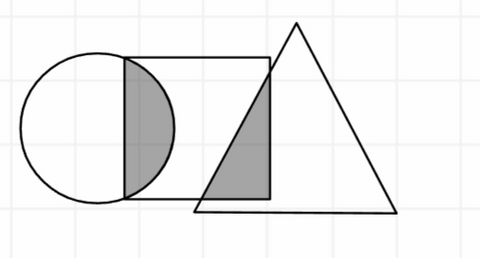

# 第1讲 · 日积月累错题重做

> 顾景源 · 五年级数学 · 学而思秋季班  
> **打印版：** `第1讲-日积月累错题重做.pdf`

---

## 第 1 题　（第1讲-大开眼界-2）

如图，圆中阴影部分的面积占圆面积的 $\frac{1}{6}$，占正方形面积的 $\frac{1}{5}$；三角形中阴影部分面积占三角形面积的 $\frac{1}{9}$，占正方形面积的 $\frac{1}{4}$，则圆、正方形、三角形的面积的最简整数比是 __________ 。

## 第 2 题　（第1讲-大显身手-3）

*校内：【2021-2022 年云南红河期末真题】*

如果甲数与乙数的比是 $7:6$，乙数与丙数的比是 $7:8$，则甲数与丙数的比是 __________ 。

## 第 3 题　（第1讲-融会贯通-7）

*校内：【2025 年 XSC 真题】*

如果 $x$ 与 $y$ 互为倒数，且 $x : 8 = \frac{a}{y}$，那么 $14a =$ __________ 。
